# Breaking Into Data


*Which data careers combine strong pay, remote flexibility, and accessible entry requirements — analyzed in Excel.*

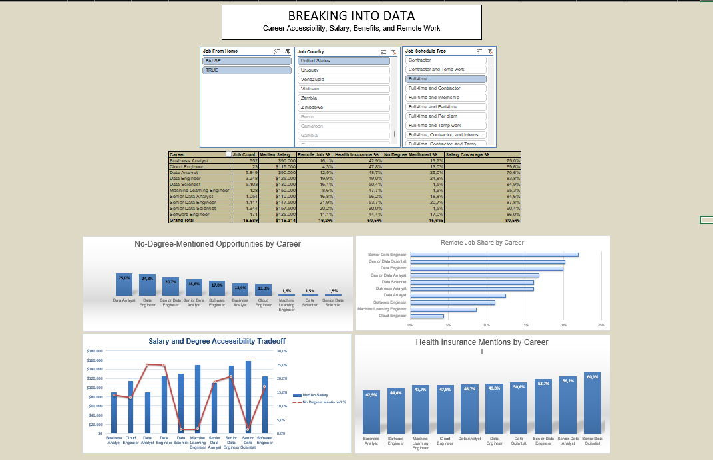

<sub>The Project Overview sheet: the Career Overview PivotTable, four PivotCharts, and the Country, Schedule Type, and Work From Home slicers collected in one view, set to United States and Full-time.</sub>

## Project Overview

**Breaking Into Data** is an Excel analytics project examining which data careers offer the strongest combination of job demand, salary, remote-work flexibility, degree accessibility, health-insurance mentions, and technical-skill demand. It analyzes 32,672 job postings from 2023 using Power Query for data cleaning, the Excel Data Model for relational modeling, DAX for filter-aware measures, and PivotTables, PivotCharts, and slicers for interactive exploration.

Throughout, the analysis reports what postings **mention** rather than what they **require** — the source fields support the weaker claim only.

## Key Findings

Scope: **18,589 United States full-time postings**, remote and non-remote combined.

| # | Question | Finding |
|---|---|---|
| 1 | Highest job demand | **Data Analyst** leads with **5,849** postings |
| 2 | Highest median salary | **Senior Data Scientist** at **$157,500** |
| 3 | Largest remote share | **Senior Data Engineer** at **21.9%** |
| 4 | Largest no-degree-mentioned share | **Data Analyst** at **25.0%** |
| 5 | Most frequent health-insurance mentions | **Senior Data Scientist** at **60.0%** |
| 6 | Salary vs. degree accessibility | **Real on the science track, absent on the engineering track.** Only **1.5%** of Senior Data Scientist postings (**$157,500**) carry an explicit no-degree signal, against **20.7%** for Senior Data Engineer (**$147,500**) |
| 7 | Most requested skill | **SQL**, in **49.9%** of Business Analyst postings in scope |

Row 7 uses the Top Skills scope — Business Analyst, full-time, United States, No Degree Mentioned = FALSE. See [Top Skills for the Selected Role](#4-top-skills-for-the-selected-role).

## Business Questions

1. Which data careers have the greatest job demand?
2. Which careers offer the highest median salaries?
3. Which careers have the largest share of remote job postings?
4. Which careers have the highest share of postings where a degree is not mentioned?
5. Which careers most frequently mention health insurance?
6. Is there a tradeoff between salary and degree accessibility?
7. Which technical skills are requested most frequently under the selected filters?

## Data

| Item | Value |
|---|---|
| Data source | `lukebarousse/data_jobs` — https://huggingface.co/datasets/lukebarousse/data_jobs |
| Collection method | Job-posting data collected through SerpAPI, as documented by the dataset/course source |
| Dataset period | 2023 |
| Job postings analyzed in this workbook | **32,672** |
| Career categories | 10 |
| Headline scope used in this README | United States, full-time — **18,589** postings |
| Postings with annual salary data, headline scope | **14,972** of 18,589 (**80.5%**) — see Caveats |
| Dataset license | Apache License 2.0 |

The original public dataset contains approximately 786,000 job postings. This Excel project uses a 32,672-row subset provided for the course project. The difference reflects the scope of the project source rather than rows removed through Power Query cleaning.

**Every row in this subset discloses a salary:** 22,036 postings list a yearly salary and 10,636 list an hourly one; none lists neither. So the workbook describes postings that disclose pay, not all Data Analyst, Data Scientist, etc. postings. Job counts, remote share, degree-mention share and insurance-mention share are all measured within this salary-disclosing group.

All salary figures are annual averages in USD and reflect the 2023 market. Figures quoted throughout this README are the headline scope — United States, full-time — unless stated otherwise; the workbook's slicers reach the rest.

Screenshots use a regional number format: `5.849` means 5,849, `$90.000` means $90,000, and `16,1%` means 16.1%.

## Opening the Workbook

[`Project_Excel_Analysis.xlsx`](Project_Excel_Analysis.xlsx) uses Power Query, the Excel Data Model, and DAX measures. Start on the `Project Overview` sheet; the Top Skills analysis is on the `Skills` sheet.

- **Required:** Excel for Windows — Microsoft 365, or Excel 2016+ Professional Plus / 2019 / 2021 / 2024
- **Not supported:** Excel for Mac and Excel for the web, which cannot edit the Power Pivot Data Model
- Enable the Power Pivot add-in: *File → Options → Add-ins → COM Add-ins → Microsoft Power Pivot for Excel*

The PivotTables, PivotCharts, and slicers work from the data already stored in the workbook. Refreshing is different: the Power Query queries load from the course's source workbook, which is not included in this repository, so **Refresh** will fail unless that file is available at its original path. To refresh with your own copy, go to *Data → Get Data → Data Source Settings → Change Source* and point the queries to it.

---

## Analysis

Sections 1–3 share one slicer selection — Country = United States, Schedule Type = Full-time, Work From Home unfiltered — so their numbers agree with each other and with Key Findings. Section 4 has its own slicers.

### 1. Career Overview

The Career Overview PivotTable compares careers on Job Count, Median Salary, Remote Job %, Health Insurance %, No Degree Mentioned %, and Yearly Salary %.

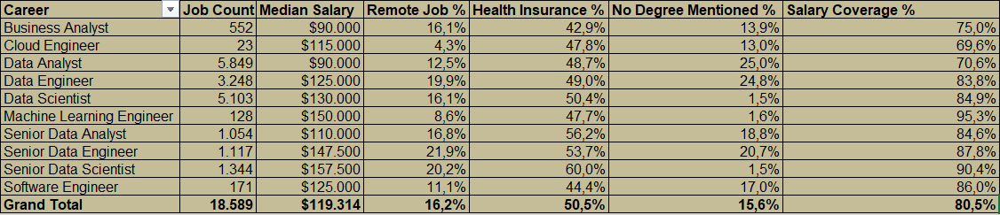

**Insight:** Demand concentrates in two careers that split on pay. Data Analyst is the largest market (**5,849** postings) but ties Business Analyst for the lowest median salary (**$90,000**), while Data Scientist pairs similar volume (**5,103**) with **$130,000**.

### 2. Career Analysis Charts

Three PivotCharts compare accessibility and employment conditions across data careers.

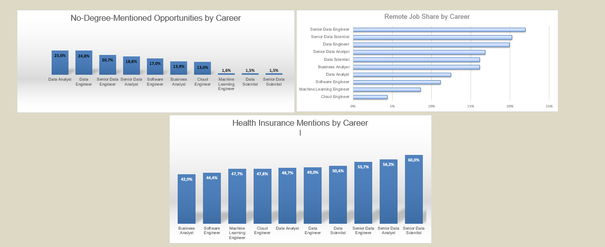

**No-Degree-Mentioned Opportunities by Career** — the percentage of postings flagged as not mentioning a degree.

**Insight:** The analyst and engineer tracks carry the strongest no-degree signal — **25.0%** of Data Analyst and **24.8%** of Data Engineer postings — against **1.5–1.6%** for Data Scientist, Senior Data Scientist, and Machine Learning Engineer.

**Remote Job Share by Career** — the percentage of postings marked as remote for each career.

**Insight:** Remote work concentrates in engineering and senior roles — Senior Data Engineer at **21.9%**, Senior Data Scientist at **20.2%**, and Data Engineer at **19.9%** — while Data Analyst sits at **12.5%**.

**Health Insurance Mentions by Career** — the percentage of postings in which health insurance is mentioned.

**Insight:** The three senior roles lead on insurance mentions — Senior Data Scientist **60.0%**, Senior Data Analyst **56.2%**, Senior Data Engineer **53.7%** — against **42.9%** for Business Analyst. Half of all postings in scope (**50.5%**) mention it.

### 3. Salary vs. Accessibility

This PivotChart plots Median Salary as columns and No Degree Mentioned % as a line on a secondary axis.

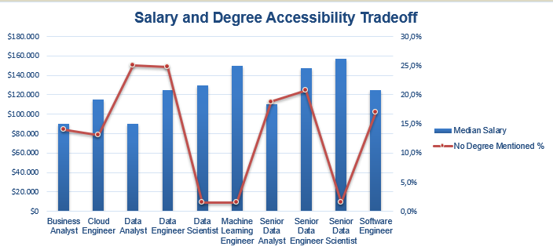

**Insight:** There is no single tradeoff. On the science track, the highest pay comes with almost no explicit no-degree signal — Senior Data Scientist at **$157,500** with just **1.5%** of postings flagged — but the engineering track breaks the pattern: Senior Data Engineer pays **$147,500** at **20.7%**, and Data Engineer **$125,000** at **24.8%**.

### 4. Top Skills for the Selected Role

The Top Skills analysis uses the normalized `Skills` table, the Jobs-to-Skills relationship, and the `Skill Frequency` measure. A Top 10 value filter keeps the ten most frequently listed skills.

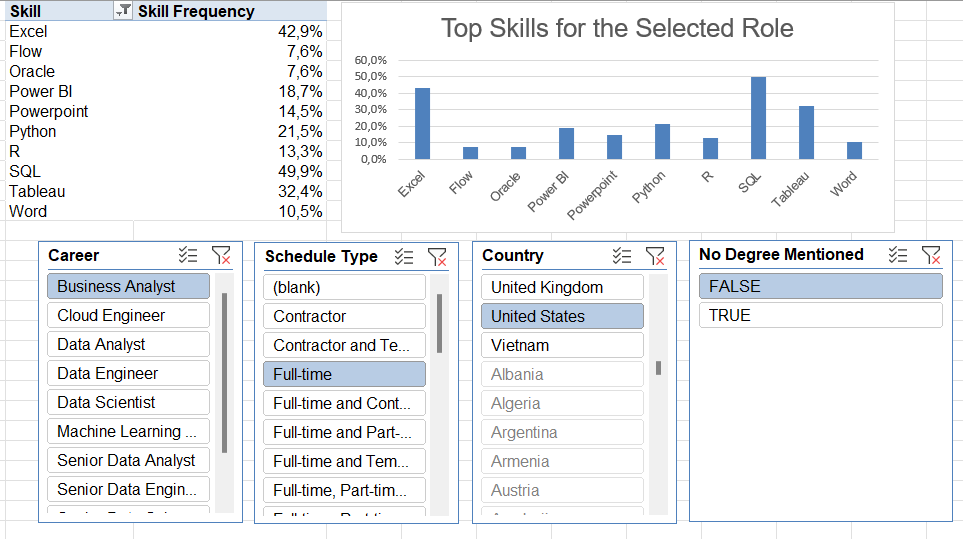

`Skill Frequency` is the only value plotted — the share of postings in scope that list each skill, so the figures stay readable as slicer selections change. This chart keeps its own slicers, separate from the Jobs-side analyses above, because the question it answers is role-specific.

The screenshot is taken in this state:

- Career: **Business Analyst**
- Schedule type: **Full-time**
- Country: **United States**
- **No Degree Mentioned = FALSE**

`No Degree Mentioned = FALSE` means the posting was not identified as explicitly indicating that no degree was required. It does not necessarily mean that a degree was mentioned or required. The skill percentages therefore represent postings where an explicit no-degree condition was not detected.

**Insight:** The Business Analyst toolkit is query-and-reporting first, not programming first — SQL appears in **49.9%** of postings and Excel in **42.9%**, roughly double Python at **21.5%**.

## Interactive Demo

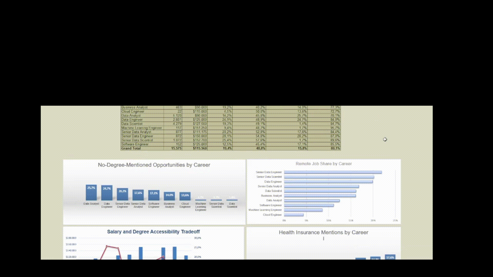

The GIF demonstrates the slicers on the Project Overview sheet updating the PivotTable and PivotCharts. Its figures follow each selection, so they differ from the headline figures quoted above.

---

<details>
<summary><strong>Technical build: Power Query, Data Model, slicers, and DAX</strong></summary>

### Power Query: Jobs

The `Jobs` query loads the course workbook's `data_jobs_salary` sheet and contains one row per job posting. Power Query keeps the analytical fields, assigns data types, and adds a unique `job_id` from an index column, stored as cleaned, trimmed text. No rows are filtered out.

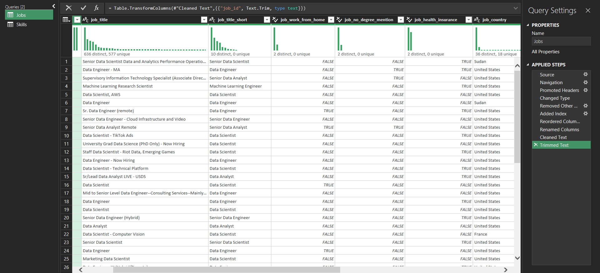

Retained fields:

```text
job_id
job_title
job_title_short
job_work_from_home
job_no_degree_mention
job_health_insurance
job_country
job_schedule_type
salary_year_avg
job_skills
```

`job_title` is the title as posted; `job_title_short` is the dataset's grouping of those titles into the 10 career categories used throughout this analysis. `job_skills` is kept so the Skills query can split it into rows.

### Power Query: Skills

A separate `Skills` query turns the multi-skill text field into one skill per row. It references the `Jobs` query, so both tables share the same `job_id` values.

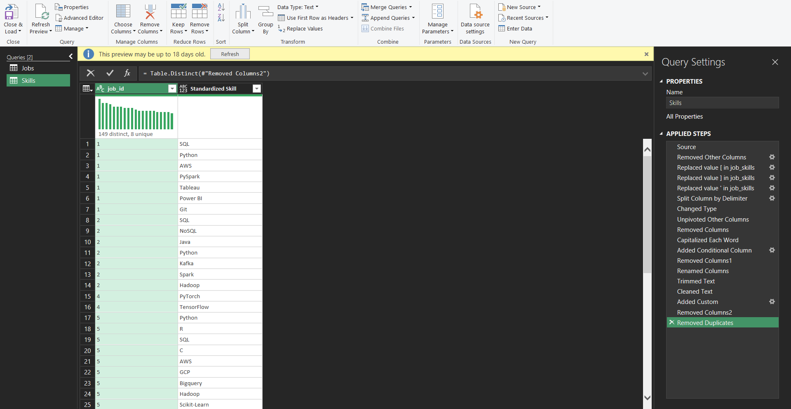

Transformations:

- Keeping `job_id` and the raw `job_skills` field
- Stripping list syntax — brackets and quotes — from `job_skills`
- Splitting by delimiter, then unpivoting so each skill becomes its own row
- Replacing non-breaking spaces, then trimming and cleaning the text
- Standardizing names with a list of exceptions — `SQL`, `AWS`, `GCP`, `SAS`, `NoSQL`, `Power BI`, `T-SQL`, `PySpark`, `PyTorch`, `TensorFlow` — and proper case for everything else
- Removing duplicate `job_id` and skill combinations

The result supports accurate skill-level counting:

```text
job_id | Standardized Skill
1      | SQL
1      | Python
1      | AWS
2      | SQL
2      | NoSQL
```

### Power Pivot Data Model

The `Jobs` and `Skills` tables are loaded into the Data Model and connected through `job_id`.

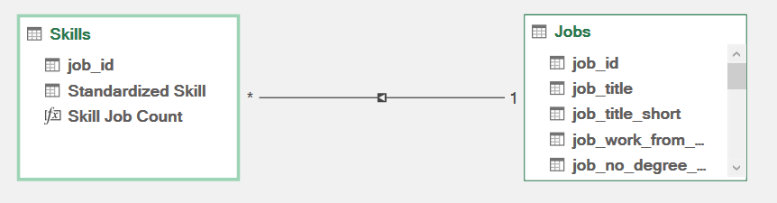

```text
Jobs[job_id] 1 ───── * Skills[job_id]
```

`Jobs` holds one row per posting; `Skills` can hold several rows for one posting because a posting may list several skills.

Filter context propagates from `Jobs` to `Skills` along the one-to-many relationship, so every Jobs-side slicer filters the skill measures without bidirectional filtering being enabled.

It does not propagate the other way, and that matters twice. It is what makes `Skill Frequency` correct: a skill on rows filters `Skills` but not `Jobs`, so the denominator `[Job Count]` stays the total for the slicer selection instead of collapsing to the postings that list that skill. It is also why skill-level salary analysis is listed under **What's Next** rather than built here — it would need a measure that pushes the skill selection back onto `Jobs`.

### Slicers and Report Connections

Slicers connect to the source PivotTables through Report Connections; each PivotChart follows its source PivotTable.

| Slicer | Connected to |
|---|---|
| Country | All main Jobs PivotTables |
| Schedule Type | All main Jobs PivotTables |
| Work From Home | All main Jobs PivotTables except the one behind Remote Job Share — see Caveats |

The Top Skills analysis has its own Career, Schedule Type, Country, and No Degree Mentioned slicers and is not connected to the slicers above.

### DAX Measures

Explicit DAX measures make every result respond to PivotTable rows, filters, and slicers.

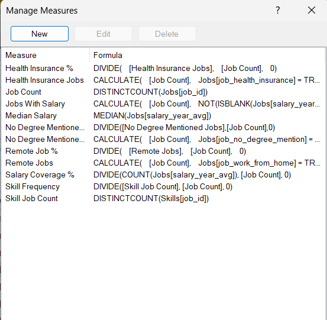

#### Core measures

```DAX
Job Count :=
DISTINCTCOUNT(Jobs[job_id])

Median Salary :=
MEDIAN(Jobs[salary_year_avg])
```

#### Accessibility metrics

All three accessibility metrics follow one pattern — a `CALCULATE` that adds one TRUE filter to `[Job Count]`, divided by `[Job Count]` for the same selection:

```DAX
Remote Jobs :=
CALCULATE([Job Count], Jobs[job_work_from_home] = TRUE())

Remote Job % :=
DIVIDE([Remote Jobs], [Job Count], 0)
```

| Count measure | Share measure | Filter applied |
|---|---|---|
| `Remote Jobs` | `Remote Job %` | `job_work_from_home = TRUE` |
| `No Degree Mentioned Jobs` | `No Degree Mentioned %` | `job_no_degree_mention = TRUE` |
| `Health Insurance Jobs` | `Health Insurance %` | `job_health_insurance = TRUE` |

Each share measure is formatted as a percentage with one decimal place:

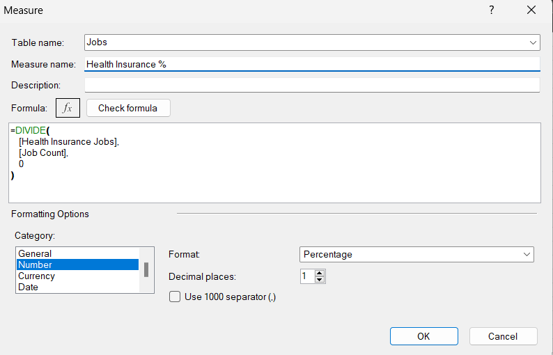

#### Salary coverage

```DAX
Yearly Salary % :=
DIVIDE(
    COUNT(Jobs[salary_year_avg]),
    [Job Count],
    0
)

Jobs With Salary :=
CALCULATE([Job Count], NOT(ISBLANK(Jobs[salary_year_avg])))
```

`Yearly Salary %` sizes the salary caveat: the share of postings in the current filter context that list a *yearly* salary. Because every row in this subset discloses some salary, the remainder are hourly-paid postings, not postings without pay information. It counts the yearly-salary column directly, and it is the only coverage figure shown in the Career Overview PivotTable. `Jobs With Salary` is a supporting count of the same postings — **14,972** in the headline scope — and is not displayed there.

#### Skill measures

```DAX
Skill Job Count :=
DISTINCTCOUNT(Skills[job_id])

Skill Frequency :=
DIVIDE([Skill Job Count], [Job Count], 0)
```

`Skill Job Count` counts the distinct postings that list a skill. `Skill Frequency` divides it by `[Job Count]` to express demand as a share of postings rather than a raw count, so values stay comparable across slicer selections and across roles.

### Project Workflow

```text
Raw Job Data
    ↓
Power Query Cleaning
    ↓
Jobs and Skills Tables
    ↓
Power Pivot Data Model
    ↓
DAX Measures
    ↓
PivotTables
    ↓
PivotCharts and Slicers
    ↓
Career Accessibility Insights
```

</details>

---

## Caveats

- **Scope.** All headline figures are United States, full-time postings — **18,589** of them. Other countries and schedule types are in the workbook and reachable through the slicers, but the numbers quoted in this README are not global.
- **Salary coverage.** Median salary is computed only from postings that list a *yearly* salary. Within the headline scope of **18,589** United States full-time postings, **80.5%** (**14,972**) list one; the other **3,617** list an hourly rate only and are left out of the medians. This matters most for Data Analyst, where **29.4%** of the headline-scope postings are hourly-only: if hourly rates were converted at 2,080 hours a year (my assumption, not a source figure), the Data Analyst median would be about **$84,157** instead of **$90,000**, below Business Analyst at about **$87,978**. Treat the Data Analyst vs Business Analyst tie at $90,000 with that in mind. This figure applies only to the selected headline scope and should not be interpreted as the salary disclosure rate of either the full 32,672-row project subset or the approximately 786,000-row upstream dataset. Coverage is also uneven by career — from **69.6%** for Cloud Engineer to **95.3%** for Machine Learning Engineer — so cross-career salary comparisons rest on slightly different foundations. The workbook contains only salary-disclosing postings (see **Data** above), so demand, remote-work, degree-mention, and insurance-mention metrics describe that group and may differ from the full job market (in the full dataset used in my SQL project, only 2.8% of Data Analyst postings list a yearly salary).
- **Small samples.** Cloud Engineer (**23** postings), Machine Learning Engineer (**128**), and Software Engineer (**171**) carry far less weight than Data Analyst (**5,849**) or Data Scientist (**5,103**). Percentages for the small three can move several points on a handful of postings and should not be read as precise.
- **Career labels come from the source.** `job_title_short` is the dataset's own grouping of free-text titles, and it is approximate on seniority: the Jobs query preview shows "Sr. Data Engineer (remote)" labeled **Data Engineer**, not Senior Data Engineer. Senior versus non-senior comparisons should be read with that in mind.
- **The Work From Home slicer is not connected to the PivotTable behind Remote Job Share.** Filtering to remote-only postings would force that ratio toward 100% and remove the comparison the chart exists to make.
- **Mentioned is not required, and the flags are not symmetric.** `job_no_degree_mention = TRUE` means a degree was not mentioned, not that no degree is required. `job_no_degree_mention = FALSE` means the posting was not identified as explicitly indicating that no degree was required; it does not necessarily mean that a degree was mentioned or required. Likewise, `job_health_insurance = TRUE` means insurance was mentioned, not that unmentioned postings lack it.
- **Blank is not zero.** A missing salary is absent information, not a salary of zero; the `Median Salary` measure ignores blanks rather than counting them as values.
- **Skill shares use every posting in scope.** `Skill Frequency` divides by all postings in the selection, including postings that list no skills, so each percentage is a share of all postings rather than of postings with a skill list.

## Challenges and Solutions

### Normalizing multi-value skills

The original skill field stored several skills in one cell as list-style text, with inconsistent capitalization. Power Query stripped the list syntax, split and unpivoted the field into rows, cleaned and standardized the names, and removed duplicate job-skill combinations.

### Modeling one job with many skills

The Skills table intentionally repeats `job_id`. A one-to-many relationship connects each unique job in Jobs to all related skills in Skills, which keeps `DISTINCTCOUNT` job counts correct while still allowing skill-level aggregation.

## What I Learned

This project strengthened my ability to:

- Build repeatable Power Query transformations
- Normalize multi-value text into an analysis-ready structure
- Create and troubleshoot one-to-many relationships
- Write filter-aware DAX measures
- Build PivotTables from the Data Model
- Create PivotCharts from reusable measures
- Configure slicers and report connections intentionally
- Distinguish missing data from true zero values
- Interpret imperfect real-world fields carefully
- Document an Excel analytics project for a portfolio

## What's Next

- **Median salary by skill.** The obvious next chart is also the one the current model cannot produce. Filter context flows from `Jobs` to `Skills` along the one-to-many relationship but not back, so putting `Skills[Standardized Skill]` on rows leaves `MEDIAN(Jobs[salary_year_avg])` unfiltered and every skill returns the same grand-total median. Answering it properly needs a measure that pushes the skill selection back onto Jobs — `CALCULATE([Median Salary], TREATAS(VALUES(Skills[job_id]), Jobs[job_id]))` — or a change of filter direction, plus a minimum-posting threshold so a skill named in a handful of listings cannot top the ranking.
- Add a year dimension to compare 2023 against later postings and separate trend from snapshot
- Test whether the no-degree-mentioned share is a genuine accessibility signal or a posting-style artifact that varies by company size

## Repository Structure

```text
breaking-into-data-excel/
├── README.md
├── LICENSE
├── Project_Excel_Analysis.xlsx
├── 00-project-overview.png
├── 01-power-query-jobs.png
├── 02-power-query-skills.png
├── 03-power-pivot-relationship.png
├── 04-dax-measures.png
├── 04b-dax-health-insurance-percentage.png
├── 05-pivottable-career-overview.png
├── 06-chart-career-analysis.png
├── 07-chart-salary-accessibility-tradeoff.png
├── 08-chart-top-skills-by-role.png
└── 09-project-demo.gif
```

`Project_Excel_Analysis.xlsx` includes the 32,672-row project subset. The full upstream dataset is not included; its public source is linked in **Data** above.

## License

Two licenses apply, to different things.

**This repository** — the workbook structure, Power Query transformations, DAX measures, PivotTables, PivotCharts, and this documentation — is released under the **MIT License**. See [LICENSE](LICENSE).

**The underlying data** is not covered by that license. `lukebarousse/data_jobs` is distributed by Luke Barousse under the [Apache License 2.0](https://www.apache.org/licenses/LICENSE-2.0) and remains subject to its own terms, including attribution. The 32,672-row project subset stored in `Project_Excel_Analysis.xlsx` comes from that dataset and stays under the Apache License 2.0, not MIT. The full upstream dataset is not redistributed here; its public source is linked in **Data**.
